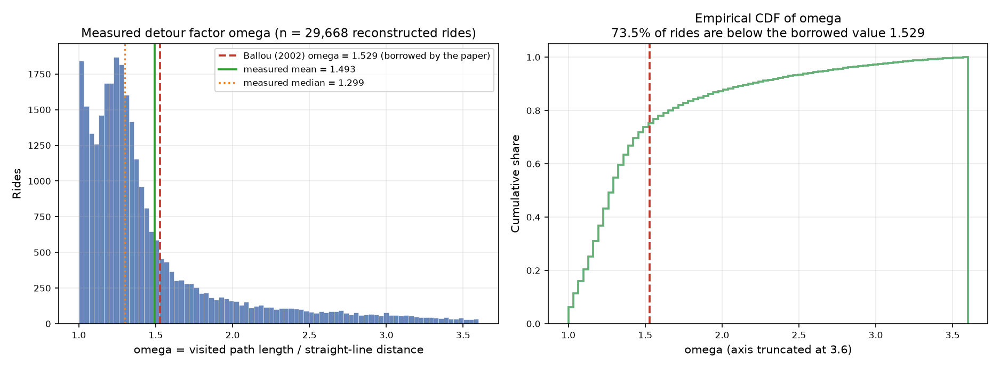
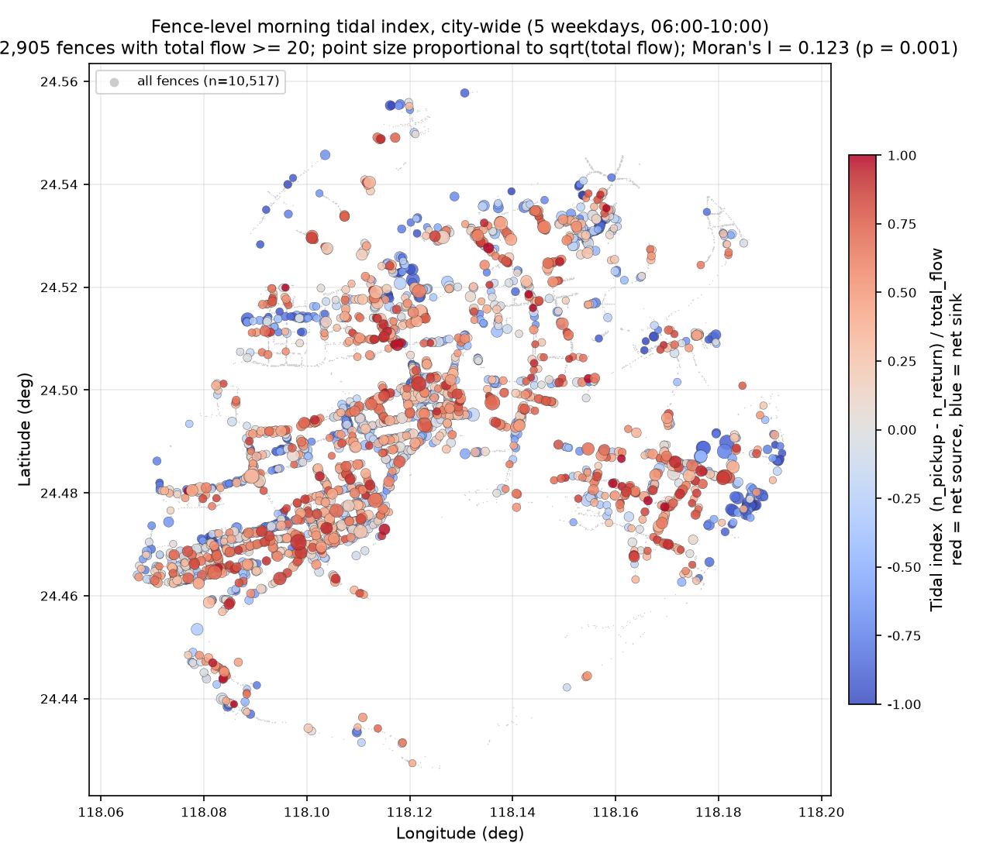

# Xiamen Shared-Bicycle Tidal Imbalance

**Measuring how a city's morning bike-share flow becomes unbalanced across 10,517 electronic
fences — and testing whether the detour factor that scheduling models borrow from the literature
actually holds in this city.**

CISC7204 Data Science semester project · Class B, Team 02 · Qu Ying (MC641326)

[](#requirements)
[](Xiamen_SharedBicycle_Analysis.ipynb)
[](#data-source-and-permissions)
[](LICENSE)

---

## Contents

1. [Research question](#1-research-question)
2. [Headline results](#2-headline-results)
3. [Two key visualisations](#3-two-key-visualisations)
4. [Data source and permissions](#4-data-source-and-permissions)
5. [Method](#5-method)
6. [Findings](#6-findings)
7. [Limitations](#7-limitations)
8. [Reproducing the analysis](#8-reproducing-the-analysis)
9. [Repository structure](#9-repository-structure)
10. [Interactive dashboards](#10-interactive-dashboards)
11. [Project status](#11-project-status)
12. [Licence and citation](#12-licence-and-citation)

---

## 1. Research question

**Main question.** During the 06:00–10:00 peak, how is shared-bicycle demand out of balance across
Xiamen's electronic fences, and how far can a *single, borrowed* detour factor be trusted when a
rebalancing plan is priced with it?

Four sub-questions drive the analysis:

| # | Question | Why it matters |
|---|---|---|
| **RQ1** | How is net inflow/outflow distributed across the city's fences, how strongly is it spatially clustered, and how does it evolve over eight 30-minute slots? | Rebalancing is only possible where the imbalance is *stable and local*. If sources and sinks are street-scale, a district-level plan cannot fix them. |
| **RQ2** | What is the **measured** detour factor ω (path length ÷ straight-line distance) in this dataset, and is it constant across functional zones and hours? | Rebalancing cost models need ω. The published scheduling model imports ω = 1.529 from Ballou (2002) and never measures it. |
| **RQ3** | Does a community structure built on OD *flow direction* outperform the published distance + demand-correlation affinity clustering for operational purposes? | A rebalancing zone should be internally balanced, which affinity clustering does not target. |
| **RQ4** | How well can fence-level 30-minute demand be predicted under an honest, date-grouped validation scheme? | Short-horizon forecasts are what a dispatcher would actually use. |

## 2. Headline results

| Item | Result |
|---|---|
| Data parsed | 441,350 order events · 10,522 fence rows (10,517 unique polygons) · 2,849,243 GPS fixes · 144 hourly weather rows |
| Trips reconstructed | **212,680** with duration in [60, 3600] s (+0.02 % vs the published 212,630) |
| Endpoint → fence match | 67.07 % (containment + 50 m snap; 1.90 % with containment alone) |
| **RQ1** | 1,075 net-source vs 1,049 net-sink fences; Moran's I = **0.123** (p = 0.001); the morning tilt reverses at **08:00–08:30** |
| **RQ2** | ω = **1.493** mean / **1.299** median over 29,668 rides; zone p = 1.5e-12, hour p = 4.1e-04 → **not constant** |
| **RQ3** | Louvain: 7 communities, modularity **0.716**, net-flow imbalance 0.0225 vs baseline 0.642 / 0.0871 |
| **RQ4** | Leave-one-day-out MAE 3.730, R² 0.430, r 0.670; held-out future morning MAE 2.734, R² 0.704, r 0.849 |

## 3. Two key visualisations

**Finding 1 — ω is not the borrowed constant.** Measured on 29,668 reconstructed rides, the detour
factor averages 1.493 but has a wide right tail, and 73.5 % of rides fall *below* the 1.529 the
published model assumes. X-axis: ω (path length ÷ straight-line distance, unitless). Y-axis, left:
number of rides; right: cumulative share.



**Finding 2 — the morning is a two-sided tide.** City-wide fence-level tidal index, where
`tidal_index = (n_pickup − n_return) / (n_pickup + n_return)` over the five mornings (06:00–10:00),
range [−1, +1]. Red = net source (bicycles leave), blue = net sink (bicycles accumulate); point size
is proportional to √(total flow). Grey dots are all 10,517 registered fences. Coordinates are
WGS-84 degrees.



Ten further figures — slot-by-slot evolution, ω by zone and by hour, the community map, prediction
scatter, permutation importance, the unmatched-endpoint map and the reproduction checks — are in
[`figures/`](figures/) and are discussed in [`docs/FINAL_REPORT.md`](docs/FINAL_REPORT.md).

## 4. Data source and permissions

| Item | Detail |
|---|---|
| Dataset | *Shared bicycle data* (Xiamen, 2020-12-21 → 2020-12-25), 96 MB archive |
| Source | Zenodo record **10.5281/zenodo.17415891** — <https://doi.org/10.5281/zenodo.17415891> |
| Licence | **CC BY-NC 4.0** (Attribution–NonCommercial 4.0 International) |
| Permission to use | The licence grants reuse, redistribution and adaptation for non-commercial purposes with attribution. This project is coursework, i.e. non-commercial, and the source is attributed here and in every figure caption and report. |
| Coordinate system | WGS-84 · time zone UTC+8 |
| Coverage | 5 consecutive weekdays, morning peak 06:00–10:00 only |

**The raw archive is deliberately not committed to this repository.** It is a 96 MB third-party
archive under a NonCommercial licence, and re-hosting it here would be both unnecessary and a
licence grey area. [`data/DOWNLOAD.md`](data/DOWNLOAD.md) gives the exact download route, the
SHA-256 of the archive this analysis was run against, and the extraction step. Every file the
notebook needs is instead committed under [`figures/`](figures/) *derived* from that archive, so a
reader can re-run the whole narrative without downloading anything.

The archive's own README is mirrored as [`data/DATA_DICTIONARY.md`](data/DATA_DICTIONARY.md) so that
field meanings and units stay visible without the archive.

## 5. Method

The pipeline is one module per stage, `M0` → `M11`, all implemented from scratch in `xm_core.py`
(no geopandas, no statsmodels, no shapely):

| Stage | What it does | Output |
|---|---|---|
| M0 | Finds and extracts the archive, classifies tables by column-name heuristics, cross-checks against the archive's data dictionary | `data_inventory.md` |
| M1 | Data-quality report: row counts, dtypes, coordinate ranges, duplicates, parse failures | `data_quality_report.md`, `data_quality_metrics.json` |
| M2 | Rebuilds trips by pairing `LOCK_STATUS` 0→1 per bicycle in time order, keeping durations in [60, 3600] s | `od_trips.csv` |
| M3 | Assigns endpoints to fences with `matplotlib.path.Path.contains_point` + bounding-box prefilter, plus a 50 m snap tier | `o_fence_id`, `d_fence_id`, `fence_match_rate.json` |
| M4 | Joins hourly weather as a **control variable only; not causal** | weather columns in the panel |
| M5 | Fence × 30-minute panel with `tidal_index` | `panel_fence_halfhour.csv` |
| M6 | Re-computes four published statistics as a **pipeline validation, not our finding** | `validation.json` |
| M7 | Tidal structure: city-wide map, slot evolution, Moran's I with 999 permutations | `fig_tidal_*.png`, `tidal_top_fences.csv`, `morans_i.json` |
| M8 | **Measured ω**: tracking episodes → path length ÷ chord, bootstrap 1000×, Kruskal–Wallis, Welch ANOVA, and a from-scratch HC1-robust OLS with zone + hour dummies | `omega_*.json/csv`, `fig_omega_*.png` |
| M9 | OD network (`W = OD + ODᵀ`) → Louvain, benchmarked against a reproduced paper-style affinity + K-Means++ baseline | `community_*.csv/json`, `fig_community_map.png` |
| M10 | `HistGradientBoostingRegressor` with **leave-one-day-out** grouped cross-validation (no random K-fold: it leaks the future) | `model_metrics.json`, `fig_pred_*.png` |
| M11 | Interactive Folium map, and two dashboards: Plotly–Dash on the finished artifacts, and a live Kafka → Spark → MySQL → FastAPI replay ([§10](#10-interactive-dashboards)) | `folium_tidal_map.html`, `dash_app.py`, `dashboard/` |

Two rules were held throughout, and both are visible in the code comments:

* **Weather is a control variable only; not causal.** Five days with exactly one rainy day confounds
  weather with day-of-week.
* **The four M6 checks are a reproduction check for pipeline validation, not our finding.**

## 6. Findings

**RQ1 — the tide is two-sided and street-scale.** 1,075 fences are net sources (tidal index > +0.2)
and 1,049 are net sinks (< −0.2); the interquartile range of the index is −0.391 to +0.400, so the
city is strongly polarised rather than mildly noisy. Moran's I on a 500 m distance band is **0.123**
(expectation −0.0003, z = 37.7, permutation p = 0.001, 89,614 neighbour pairs): imbalance comes in
neighbourhoods. The share of net-source fences falls from 47.8 % at 06:00–06:30 to 37.5 % at
08:00–08:30, the slot where net sinks peak — the moment the residential outflow has been absorbed by
the office/metro inflow.

**RQ2 — ω is measurable, and it is not a constant.** Mean **1.493** (95 % bootstrap CI 1.4868–1.5000),
median **1.299**, 95th percentile 2.82, over 29,668 rides. 73.5 % of rides sit below 1.529. Riding out
of a residential net-source area detours measurably more than riding out of a sink (Kruskal–Wallis
p = 1.5e-12; the zone contrast survives an HC1-robust OLS that also controls for the hour). A single
borrowed constant misprices most trips: it overstates the cost of short residential rides and
understates the long tail.

**RQ3 — flow-based communities are better for operations.** At the same granularity (7 groups),
Louvain on the symmetrised OD graph reaches modularity **0.716** against **0.642** for the paper-style
affinity baseline, and the mean absolute within-community net-flow imbalance is **0.0225 vs 0.0871**
(3.9× better) while silhouette score is a statistical tie (0.298 vs 0.300). Affinity answers "who
demands alike"; the flow partition answers "who should be rebalanced together".

**RQ4 — history dominates, and honest validation is humbling.** Under leave-one-day-out validation the
model reaches MAE 3.730 / R² 0.430 / r 0.670, with a large fold spread (MAE 4.09 ± 1.33). Held out on
a genuinely future morning it reaches MAE 2.734 / R² 0.704 / r 0.849. Permutation importance puts
`hist_mean` (+3.12 MAE when shuffled) and `lag1_same_day` (+0.97) far ahead of the time-of-day features;
the weather controls contribute almost nothing, as expected with five days and one rainy day.

## 7. Limitations

1. **Weather cannot be interpreted causally.** Five consecutive weekdays, exactly one of them rainy:
   weather is perfectly confounded with day-of-week. Every weather variable is a control variable only.
2. **The four reproduction statistics are not our findings.** 212,630 trips in [60, 3600] s, cross-day
   r > 0.90, the 08:00–09:00 peak and the ≈60 % rainy-day drop are the published study's results,
   reproduced only to prove that this pipeline parses and pairs correctly.
3. **Observational and narrow.** One city, five mornings, morning peak only, no rider identifiers, no
   counterfactual. Everything reported is an association.
4. **The fence panel is sparse.** The prescribed `total_flow >= 10` rule retains 1,738 fence–slot cells
   over 405 fences, so RQ4 is estimated on a small but honest sample.
5. **ω is measured on tracking episodes, not confirmed trips.** Trajectory files carry no trip id and
   cover only part of each bicycle's day, so a ride is a continuous tracking episode; the independent
   check inside OD trip windows (n = 2,456, mean 1.377) bounds but cannot remove that bias.
6. **The 50 m snap radius is a modelling choice.** Match rate moves from 1.90 % (containment only) to
   88.72 % (200 m); any claim that depends on the exact rate should be read against that range.
7. **Communities are descriptive flow groupings, not administrative districts**; their boundaries shift
   with the resolution parameter and the minimum-flow floor.

The published study's own fence count is inconsistent — 14,071 in the abstract, 10,522 in the Methods;
the archive supports 10,522 rows / 10,517 unique ids. That is a reproducibility problem we found while
checking the data, and it is reported rather than smoothed over.

## 8. Reproducing the analysis

### Requirements

Python 3.11+ (tested on 3.14.7). All dependencies are in [`requirements.txt`](requirements.txt):

```bash
python -m venv .venv
# Windows
.venv\Scripts\activate
# macOS / Linux
source .venv/bin/activate

pip install -r requirements.txt
```

### Option A — read the analysis without the raw data (≈ 10 seconds)

Every artifact the notebook reads is already committed under `figures/`, so the narrative notebook
runs immediately:

```bash
jupyter lab Xiamen_SharedBicycle_Analysis.ipynb
```

Run the cells top to bottom. Expected: no cell errors, 11 figures displayed, and the numbers match
[`docs/EXPECTED_OUTPUTS.md`](docs/EXPECTED_OUTPUTS.md). A pre-rendered HTML copy is at
[`docs/rendered/Xiamen_SharedBicycle_Analysis.html`](docs/rendered/Xiamen_SharedBicycle_Analysis.html).

### Option B — regenerate everything from the raw archive (≈ 15 min cold, ≈ 1 min warm)

```bash
# 1. Put the archive in the repository root (see data/DOWNLOAD.md)
#    Expected file: "Shared bicycle data.zip"  (96 MB, SHA-256 in data/DOWNLOAD.md)

# 2. Run the full pipeline M0 -> M11
python run_pipeline.py

# 3. Resume from a stage, reusing artifacts already on disk
python run_pipeline.py --skip-to M8
```

The pipeline prints `[M3/11] ...` progress lines, per-stage wall time and peak memory, and writes
`figures/pipeline_log.json`. Then:

```bash
# regenerate the notebook and the report from the artifacts
python tools/make_notebook.py
python tools/make_report.py

# interactive dashboard on http://127.0.0.1:8050
python dash_app.py
```

**Determinism.** `RANDOM_SEED = 42` is set globally; bootstrap, permutation test, Louvain and
K-Means++ are all seeded, so two runs on the same machine produce the same numbers up to
forest/`set` iteration order.

**Known environment quirks** (documented rather than hidden, see §7 of `docs/FINAL_REPORT.md`):
`seaborn` and `statsmodels` are not required anywhere — plots use pure matplotlib and the HC1 OLS is
implemented from scratch; on Windows `psutil` is used for memory logging; the pipeline caps
scikit-learn's thread pool to one worker, which is what makes histogram binning deterministic here.

## 9. Repository structure

```
.
├── README.md                          # this file
├── requirements.txt                   # analysis pipeline + notebook + Plotly-Dash app
├── requirements-dashboard.txt         # streaming dashboard (Kafka / Spark / MySQL / FastAPI)
├── LICENSE                            # MIT for the code; data is CC BY-NC 4.0
├── CITATION.cff
│
├── xm_core.py                         # all modules M0–M11, from scratch (2,715 lines)
├── run_pipeline.py                    # one-command entry point, --skip-to M8 resume
├── dash_app.py                        # dashboard 1: Plotly–Dash, static artifacts (port 8050)
├── Xiamen_SharedBicycle_Analysis.ipynb# narrative notebook, M1–M11 in order
│
├── dashboard/                         # dashboard 2: live streaming stack
│   ├── README.md                      # quick start, API list, troubleshooting
│   ├── README_full_notes.md           # original design notes (Chinese)
│   ├── docker-compose.yml             # Kafka, Zookeeper, MySQL, Redis
│   ├── producer/                      # replays the historical orders as a Kafka stream
│   ├── spark/                         # Structured Streaming aggregation
│   ├── api/                           # FastAPI backend + WebSocket
│   ├── frontend/                      # Leaflet map + ECharts, vendored libs (no CDN)
│   ├── mysql/init/                    # schema, applied on first container start
│   └── scripts/                       # run_producer.sh, run_consumer.sh, run_api.sh
│
├── figures/                           # pipeline output directory: all figures + all artifacts
│   ├── fig_*.png                      # 11 figures, dpi >= 150, English labels, units given
│   ├── folium_tidal_map.html          # interactive map (3.6 MB)
│   ├── od_trips.csv                   # 212,680 reconstructed trips (31 MB)
│   ├── omega_trips.csv                # the 29,668 rides behind the omega estimate
│   ├── panel_fence_halfhour.csv       # fence x 30-minute panel used by RQ4
│   ├── omega_overall.json             # the headline omega estimate with bootstrap CIs
│   ├── omega_by_zone.csv              # omega by fence role, hour, community
│   ├── model_metrics.json             # MAE / RMSE / R2 / r per split, per fold, per feature
│   └── ...                            # validation, Moran's I, communities, data quality
│
├── tools/
│   ├── make_report.py                 # regenerates docs/FINAL_REPORT.md from the artifacts
│   └── make_notebook.py               # regenerates the notebook from the artifacts
│
├── docs/
│   ├── FINAL_REPORT.md                # 11-section report: four RQs, all numbers, limitations
│   ├── CODEBOOK.md                    # variables, derived measures, module map, artifact index
│   ├── DATA_DESCRIPTION.md            # what the archive contains, field by field
│   ├── REPRODUCIBILITY.md             # step-by-step verification route
│   ├── EXPECTED_OUTPUTS.md            # numbers a correct run must reproduce
│   ├── PEER_FEEDBACK.md               # review log: comment -> commit
│   └── rendered/                      # HTML render of the notebook
│
└── data/
    ├── DOWNLOAD.md                    # how to obtain the archive + SHA-256
    └── DATA_DICTIONARY.md             # the archive's own field/unit dictionary
```

## 10. Interactive dashboards

The project ships **two** dashboards. They consume the same artifacts and are independent of each
other; neither is needed to read the analysis.

| | Dashboard 1 — `dash_app.py` | Dashboard 2 — `dashboard/` |
|---|---|---|
| Purpose | Explore the finished results | Show the morning *as it happens* |
| Data path | reads the committed CSVs in `figures/` | replays `raw/Order data/order data.csv` |
| Stack | Plotly + Dash | Kafka → Spark Structured Streaming → MySQL → FastAPI + WebSocket → Leaflet / ECharts |
| Start | `python dash_app.py` → port 8050 | four terminals, see below → port 8000 |
| Needs | `pip install -r requirements.txt` | Docker, Java 17, Spark 3.5.9, Python 3.10 (`requirements-dashboard.txt`) |
| Controls | 30-minute slot slider, fence-role filter, demand curve, source/sink ranking | play/pause replay, fence filter, live net-flow map, ECharts time series, weather panel |

**Dashboard 2** replays the real historical orders as a Kafka stream; nothing is simulated. Its
front-end libraries (Leaflet, ECharts) are vendored under `dashboard/frontend/vendor/`, so the
charts need no CDN — only map tiles need internet access.

```bash
# 0. once: python 3.10 env with requirements-dashboard.txt
#    edit JAVA_HOME / SPARK_HOME / HADOOP_HOME / PY in dashboard/scripts/run_*.sh
#    credentials: copy dashboard/.env.example to dashboard/.env and set two passwords
#    (.env is git-ignored; no password is stored in this repository)

# 1. infrastructure (MySQL schema applied automatically on first start)
cd dashboard
docker compose up -d
cd ..

# 2. Spark consumer - start first, so no batch is missed
bash dashboard/scripts/run_consumer.sh

# 3. Kafka producer - replay one day, or all five
bash dashboard/scripts/run_producer.sh --date 2020-12-22

# 4. FastAPI backend + static frontend
bash dashboard/scripts/run_api.sh
#    open http://127.0.0.1:8000
```

It reads the same `raw/` tree as the pipeline, so the raw archive must be extracted once first — see
[§8 Reproducing the analysis](#8-reproducing-the-analysis). Full API list, architecture notes and
troubleshooting: [`dashboard/README.md`](dashboard/README.md).

## 11. Project status

**Status: complete and submitted for CISC7204 (2026).** All 11 modules run end to end; the four
research questions are answered with the numbers above; the limitations are stated rather than
worked around.

Planned improvements, in priority order:

1. Replace the 50 m snap tier with a probabilistic map-matching step, so the 67 % endpoint match rate
   becomes a modelled quantity rather than a radius choice.
2. Extend the window beyond the morning peak — the current panel cannot say whether evening demand
   reverses the same fences.
3. Replace the borrowed ω with the empirical distribution inside an actual rebalancing optimiser, and
   report what the plan costs differently.

## 12. Licence and citation

* **Code** (`.py`, `.ipynb`, build scripts): MIT — see [`LICENSE`](LICENSE).
* **Figures, reports, derived tables in this repository**: CC BY 4.0, please attribute.
* **Underlying data**: CC BY-NC 4.0, © the dataset authors, Zenodo 10.5281/zenodo.17415891. Not
  redistributed here.

```bibtex
@misc{qu2026xiamenbike,
  author       = {Qu, Ying},
  title        = {Xiamen Shared-Bicycle Tidal Imbalance: measuring the detour factor
                  and rebalancing zones from five mornings of GPS data},
  year         = {2026},
  howpublished = {CISC7204 Data Science semester project, University of Macau},
  note         = {Data: Zenodo 10.5281/zenodo.17415891, CC BY-NC 4.0}
}
```

Questions or corrections: open an issue on this repository.
